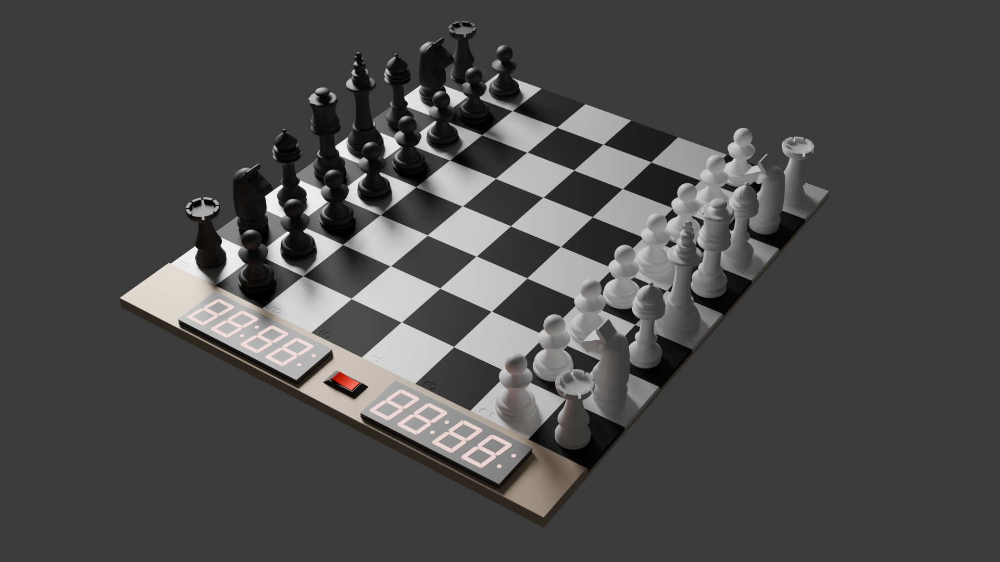

# Led-Chess-board

A pretty normal chess board on the first sight. It has two timers controlled by an ESP32, so you can also play on time.
But it has also inbuilt LEDs to make some cool effects and confuse your opponent. 😜
The chess tiles and figures are out of PETG and the housing is made of wood.

## Features:
+ WS2812
+ Esp32
