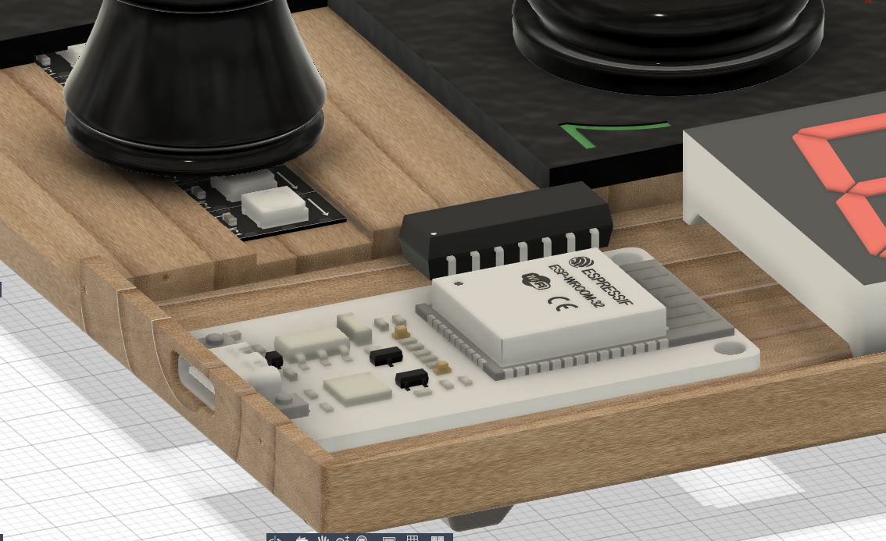

# Led-Chess-board

A pretty normal chess board on the first sight. It has two timers controlled by an ESP32, so you can also play on time.  
But it has also inbuilt LEDs to make some cool effects and confuse your opponent. 😜  
The chess tiles and figures are out of PETG and the housing is made of wood.

## Features:
+ WS2812B 144 LEDs/m, for lighting up the tiles
+ 2 Seven-Segment displays for the time
+ SN74AHCT125N levelshifter to get the 3,3V signal from the ESP32 to 5V
+ ESP32 for controlling everything
+ 3D printed chess figures and tiles for easy replacement and different colours
+ clean looking wood housing
+ additional magnet holes, may use them later

## CAD Model:
The tiles get glued on the wood  
ESP32, levelshifter and LEDs are connected by wires

